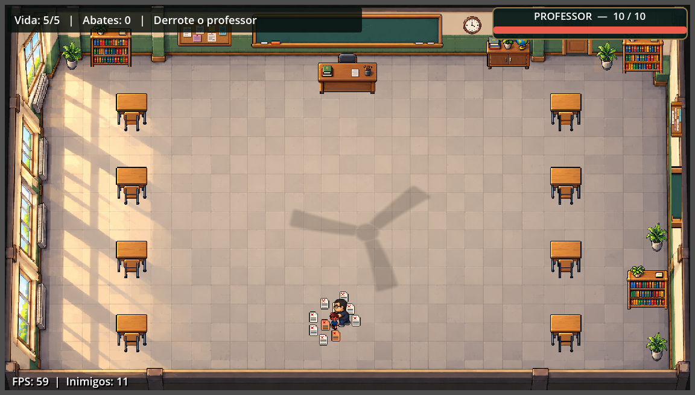

# Provas Voadoras

Jogo de Jogos Digitais II, de Alfredo Sanabria Monges, desenvolvido na Godot 4.6.3.

**Jogue no navegador:** [Provas Voadoras no itch.io](https://ghdtykcfotyfuyeu.itch.io/provas-voadoras).
Pagina publica conferida em 18/11/2026. Use o teclado para jogar.

## Carta do projeto

- **Tema:** sala de aula com provas voadoras.
- **Tipo:** Chefe — resistir ate o chefe surgir e derrota-lo.
- **Modo:** horda, com visao de cima (top-down), sem gravidade.

Sobreviva por **60 segundos** enquanto as provas perseguem o aluno. Ao terminar a
contagem, o **Professor** aparece, mesmo que ainda existam provas na sala.
Derrote o professor para vencer. A partida termina em derrota se a vida do aluno
chegar a zero.

## Como jogar

| Comando | Acao |
| --- | --- |
| WASD ou setas | Mover o aluno. |
| Espaco | Atacar com o lapis na direcao do personagem. |
| R ou botao Jogar novamente | Reiniciar depois da vitoria ou derrota. |
| F3 | Mostrar FPS e quantidade de inimigos. |

O aluno tem 5 vidas e fica protegido por 1 segundo depois de sofrer dano. O lapis
causa 1 de dano e tem recarga de 0,4 segundo; paredes e carteiras bloqueiam o golpe.
As provas tem 1 vida e causam 1 de dano. O professor tem 10 vidas e causa 2 de dano.
O painel mostra vida, abates e segundos ate o chefe; sua barra de vida aparece
quando ele nasce. O total de abates inclui o professor.

O temporizador da horda comeca em 1,5 segundo e reduz o intervalo em 5% por
nascimento, ate 0,5 segundo. Existem no maximo **10 provas e 1 professor**.
Uma prova eliminada libera uma vaga para o proximo nascimento. O professor nao
precisa esperar uma vaga da horda. O mapa inteiro cabe na camera fixa.

## Abrir e executar

1. Use a **Godot 4.6.3**, versao usada na verificacao e na exportacao.
2. Importe `project.godot` e aguarde a importacao dos sprites.
3. Pressione **F5**. A cena inicial e `scenes/sala.tscn`.

As exportacoes permitem jogar sem instalar a Godot. Veja
[como executar e publicar](docs/ENTREGA.md). A pasta `web/` contem a pagina do jogo;
o build web exportado fica em `exports/web/` e e gerado pelo workflow do repositorio.

## Pastas

| Pasta | Conteudo |
| --- | --- |
| `scenes/` | Sala principal, estrutura, interface e efeito de sombra. |
| `entities/` | Cenas reutilizaveis do aluno, provas, chefe, spawner, moveis e decoracoes. |
| `scripts/` | Codigo GDScript e shader; testes ficam em `scripts/testes/`. |
| `sprites/` | Imagens do aluno, provas, chefe e cenario; recursos das animacoes junto aos respectivos sprites. |
| `docs/` | Explicacao, creditos, captura atual, instrucoes e evidencias historicas identificadas. |
| `web/` | Pagina de apresentacao e lancamento do jogo no navegador. |
| `exports/` | Saidas geradas de Windows, Linux e Web; ignoradas pelo Git. |

## Codigo das aulas e creditos

A base de movimento, dano, ataque, navegacao, temporizadores e placar vem dos
[exemplos da aula 10 do professor Ezefferth C. A. Fernandes](https://github.com/ezefferth/construcao-jogo-godot/tree/aula-10)
e dos roteiros fornecidos. A condicao do chefe segue a ficha **Chefe** do roteiro,
pois o `vila.gd` generico do repositorio do professor ainda vence pelo relogio.
As adaptacoes e animacoes foram implementadas com auxilio de **ChatGPT/Codex**;
os scripts identificam sua origem. [Mapa das adaptacoes](docs/ORIGENS.md).

- **Artes:** imagens produzidas com o gerador de imagens do ChatGPT para este
  projeto, a partir das referencias fornecidas pelo autor. A folha do professor
  utiliza a referencia do personagem enviada na conversa. Origem:
  [ChatGPT](https://chatgpt.com/). Nao foi atribuida uma licenca de terceiros
  inexistente a essas imagens; consulte os [termos de uso](https://openai.com/policies/terms-of-use/).
- **Motor e fonte padrao incorporada:** [Godot Engine](https://godotengine.org/),
  licenca MIT; creditos e licencas dos componentes do motor em
  [Godot License](https://godotengine.org/license/) e
  [COPYRIGHT.txt](https://github.com/godotengine/godot/blob/4.6.3-stable/COPYRIGHT.txt).
- **Codigo didatico:** Ezefferth C. A. Fernandes, repositorio acima e roteiros das
  aulas 09/10. A origem e citada; nenhuma licenca MIT foi presumida para esse material.
- Nao ha trilha, efeitos sonoros ou fontes baixados de bancos externos nesta versao.

## Verificacao e processo

[DEVLOG.md](DEVLOG.md) registra a atualizacao e identifica as lacunas historicas.
[VERIFICACAO.md](docs/VERIFICACAO.md) descreve os testes da versao atual.
Nao foram criadas tags antigas para simular entregas em datas anteriores.
